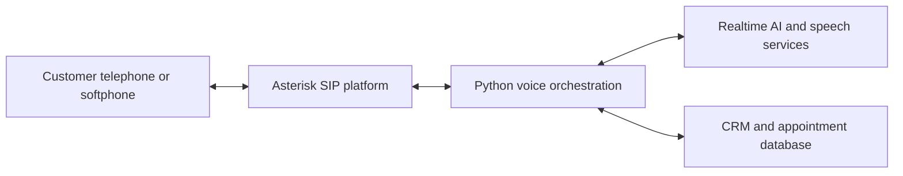

# Voice AI Appointment Assistant

A functional Voice AI prototype that handles inbound and outbound telephone conversations, connects calls with customer and appointment data, and updates a lightweight CRM in real time.

The project demonstrates how voice, AI and business applications can be integrated into a practical customer-service workflow.

## Demo scenarios

### Inbound customer service

A recognised customer calls the Voice AI assistant and can:

- Ask about upcoming appointments.
- Hear appointment dates and details naturally.
- Confirm a pending appointment.
- Receive confirmation during the call.
- See the updated status reflected in the CRM.

### Outbound appointment confirmation

A user starts a confirmation call from the CRM.

The system:

- Calls the selected customer.
- Identifies the relevant appointment.
- Asks the customer to confirm it.
- Records the result in the CRM.
- Completes the corresponding outbound queue job.

## Key capabilities

- Inbound and outbound SIP calls.
- Customer identification using the caller number.
- CRM and appointment database integration.
- AI function calling for appointment lookup and confirmation.
- European Portuguese and British English support.
- Preferred language stored per customer.
- Automated outbound confirmation queue.
- Call completion and controlled hang-up.
- Docker-based deployment.

## Two Voice AI approaches

The prototype includes two different voice architectures.

### Direct speech-to-speech

Audio is processed directly by a realtime voice model.

Advantages:

- Lower response latency.
- Natural conversational flow.
- Suitable for highly interactive calls.

Considerations:

- Less control over pronunciation and regional accent.
- Voice delivery can vary between responses.

### Chained STT, AI and TTS

The caller's speech is processed into text, business tools are executed, and the final response is generated using a separate text-to-speech stage.

Advantages:

- More control over wording and voice selection.
- Improved European Portuguese consistency.
- Easier integration of controlled business responses.

Considerations:

- Additional processing stages.
- Slightly higher latency than direct speech-to-speech.

## High-level architecture

## Technology

- Asterisk
- SIP and WebSocket media
- Python
- OpenAI Realtime and text-to-speech services
- Flask
- SQLite
- Docker and Docker Compose
- Asterisk Manager Interface

## Demo and portfolio

A demonstration video and project portfolio will be added here.

## Deployment status and roadmap

The underlying Asterisk and Python voice platform has been deployed on AWS EC2. The appointment-assistant and CRM demonstration described here is tested in a private Linux/Docker lab.

These are prototype environments. Production hardening and a protected public demonstration remain planned work.

Planned work for the appointment-assistant demonstration includes:

- Protected AWS hosting for the full demonstration.
- Secure public access to the CRM.
- Production monitoring and logging.
- SIP trunk or PSTN number integration for the demonstration.
- Configurable customer-specific workflows.
- Integration with external CRM, calendar and booking platforms.

## Source code

This repository is a public project showcase.

The implementation source code, credentials, infrastructure configuration and customer data are maintained in a separate private repository.

Private technical walkthroughs can be arranged for qualified collaboration or customer discussions.

## About

Developed by **Andre Fernandes**.

Senior Voice & Unified Communications Engineer  
CCIE Collaboration #62465

GitHub: [afernandes1](https://github.com/afernandes1)

## Status

Functional prototype under active development.
